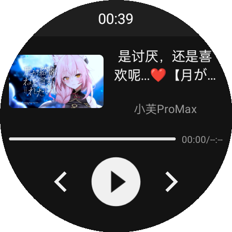
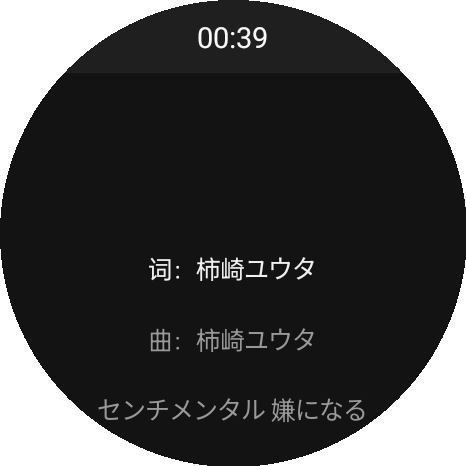
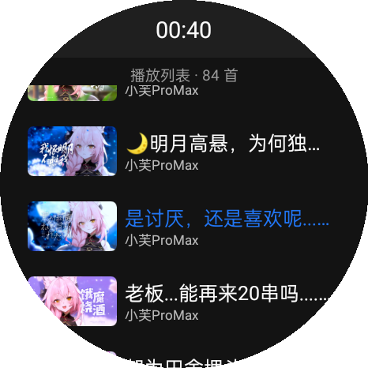
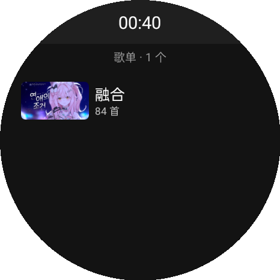
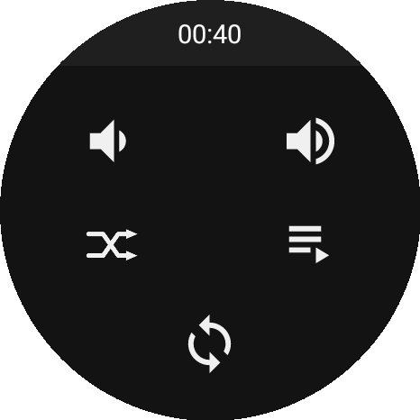

# LXXWear

LX 音乐手表端播放器（Wear OS / 安卓手表），通过局域网与手机端 [LX-N-X-Music](https://github.com/zhzipu/LX-N-X-Music) 自动同步歌单并离线播放。

<p align="center">
  
  &nbsp;&nbsp;
  
  &nbsp;&nbsp;
  
  &nbsp;&nbsp;
  
  &nbsp;&nbsp;
  
</p>


## 功能

- **横向四列页面**：歌单 → 播放器 → 播放列表 → 控制台，播放器居中
- **播放器**：封面 / 歌名 / 歌手 / 进度条与时长；点击封面在 **单曲循环 → 列表循环 → 列表随机 → 列表顺序** 间切换，时间栏提示 1 秒
- **歌词**：播放器上滑进入，LrcView 竖向拖动跳转；点时间栏返回
- **播放列表**：当前队列，正在播放的标题高亮蓝色，点一首立刻切歌
- **系统媒体会话**：注册 `MediaSessionCompat`，手表系统控件与通知栏可播放 / 暂停 / 切歌
- **记住播放**：每次切歌记录当前曲目，下次启动自动恢复到上次退出时播放的歌
- **局域网自动同步**：与手机同一 Wi-Fi 自动对齐歌单，详见下文

## 播放列表数据

应用启动时优先加载本地曲库（局域网同步产物），没有同步过才回退到 `app/src/main/assets/playlist.json`，格式：

```json
[
  {
    "name": "歌名",
    "artist": "歌手",
    "cover": "封面图片地址",
    "url": "音频地址（http(s) 或本地路径）",
    "lyric": "[00:00.00]第一句歌词\n[00:03.00]第二句歌词"
  }
]
```

`url` 为空的条目会被忽略；`cover`、`lyric` 可以为空，界面会显示占位图和「暂无歌词」。

也可以完全不用 assets，直接注入自己的数据源：

```java
PlaylistProvider.setSongs(mySongs); // 在播放器页创建之前调用
```

## 构建

本工程独立构建，不依赖手机端仓库：

```bash
git clone https://github.com/zhzipu/LXXWear.git
cd LXXWear
gradle assembleRelease          # Gradle 8.x + JDK 17
adb install -r app/build/outputs/apk/release/app-release.apk
```

- `applicationId` 为 `com.lxnx.wear`。
- 依赖 `me.wcy:lrcview:2.2` 只存在于已停服的 jcenter，根 `build.gradle` 里已用阿里云 jcenter 镜像替换。
- 仓库不含签名文件（`keystore.properties` / `*.jks` 已被 `.gitignore` 排除），release 构建需自行配置签名；
  无签名配置时会退化为 debug 签名，可直接安装。

## 局域网互联（自动对齐手机端选中的歌单）

手表和手机连同一个 Wi-Fi 就会**自动同步**，不需要点任何按钮：

- 触发时机：应用启动后约 2 秒、系统网络状态变化、每 10 分钟一次
- 判定依据：手机端 `/api/playlist` 里的 `revision`（歌单内容指纹）+ 本地曲目数量
- 版本没变 → 什么都不做；变了 → 只补缺的音频、删掉手机端已移除的歌、顺序跟随手机
- 同步不打断播放：正在播的那首若仍在新歌单里会按 `id` 保留位置，且不会自己发声，
  按播放/切歌才生效
- 找不到手机、超时都静默跳过，不弹窗

歌单同步来源是手机端**当前选中的歌单**（`playlistId` / `playlistName` 由手机端给）。

**配对**：同步页 →「配对手机」，手表显示二维码（内含手表 IP、配对端口、6 位配对码），手机扫码后
调用手表的 `/pair` 换取 token，双方绑定。配对后手表只接受带同一 token 的广播与请求，
换手机在配对页「解除配对」即可。不配对也能用，但同网段多台设备时容易同步到别人的手机。

手机端侧边栏「设置」上方的 **LXXWear** 页负责配对：点「打开相机扫码」
拍下手表屏幕上的二维码即可自动填好地址与配对码并完成配对（识别用 MLKit 离线模型，扫不出来时
页面上也有手动填 IP / 端口 / 配对码的入口）。

手动入口在**控制台页第三行的同步图标**：可以看到歌单名、本地曲目数与占用空间，也能强制重新检查、
查看具体进度和错误。同步过程中手机上没有某首歌的文件时，由手机端先自行下载（`prepare` 轮询）再发出来。

本地曲库在 `Android/data/com.lxnx.wear/files/lan_library/`，`index.json` 记录歌单信息与版本；
应用启动时优先加载它，没有同步过才回退到 `assets/playlist.json`。

完整接口、时序与自动同步策略见 **[docs/LAN_PROTOCOL.md](docs/LAN_PROTOCOL.md)**。

### 没有手机端时怎么自测

电脑上跑自带的最小服务端（只依赖 Python 标准库）：

```bash
# 把音频放进 tools/mock/media，文件名建议「歌手 - 歌名.mp3」，同名 .lrc / .jpg 会被一起发出去
python tools/mock_server.py --media tools/mock/media
```

它会在 `8686` 起 HTTP 服务、`8687` 每 2 秒发 UDP 广播；手表进同步页即可整单拉取。
记得放行防火墙的 TCP 8686 与 UDP 8687，且电脑和手表在同一网段。

## 代码结构

| 模块 | 文件 |
| --- | --- |
| 界面 | `ui/MainActivity`（横向四列 ViewPager2）、`adapter/ViewPagerAdapter`、`adapter/MusicAdapter` |
| 播放器 | `service/MusicPlayerService`（MediaPlayer + Binder + MediaSessionCompat）、`fragment/PlayerFragment` |
| 播放列表 | `fragment/QueueFragment`、`player/PlaylistProvider`、`model/Song` |
| 播放顺序 | `player/PlayOrder`（四档轮换 + 持久化）、`player/PlaybackItem` |
| 歌单 | `fragment/SongListFragment`（手机同步下来的歌单，两层：歌单 → 歌） |
| 歌词 | `fragment/LyricsFragment`（LrcView，支持拖动跳转） |
| 翻页手势 | `widget/VerticalPagerLayout` + `fragment/PlayerPagerFragment`（播放器上下两页） |
| 局域网互联 | `lan/*`（发现 / HTTP 客户端 / 整单同步 / 本地曲库）、`ui/LanActivity`、`ui/PairActivity` |

页面之间用 `LocalBroadcastManager` + `PlayerActions` 通信（进度、选歌、切歌、播放顺序）；
`PlaylistProvider` 持有播放列表和当前索引，是唯一的数据来源。

## 许可证

沿用原项目 Apache-2.0，详见 [LICENSE](LICENSE)。
